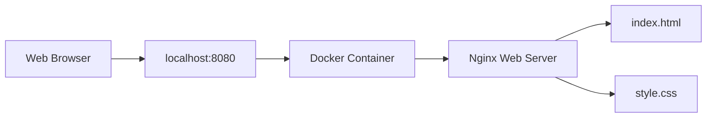

# Dockerized Web Server with Nginx

A hands-on DevOps project developed as part of my **CodeAlpha DevOps Internship** to gain practical experience with Docker containerization and Nginx web server deployment.

## Project Overview

I built this project to understand how a static website can be packaged into a Docker image and served through an Nginx web server.

The website is created using HTML and CSS, packaged with Docker, and served by Nginx inside a container. A Docker health check is also configured to verify that the web server is responding correctly.

## Project Screenshots


## Architecture

The following diagram shows how a browser request reaches the website running inside the Docker container.



## Features

- Custom Docker image based on `nginx:alpine`
- Static website served using Nginx
- Host-to-container port mapping (`8080:80`)
- Docker health check to verify web server availability
- Container status and server log inspection
- Responsive website built with HTML and CSS
- Source code version control using Git and GitHub

## Technologies Used

- **Docker** — image building and container management
- **Nginx** — web server
- **Linux (Ubuntu on WSL)** — development environment
- **HTML5 and CSS3** — website structure and styling
- **Git and GitHub** — version control and source code hosting

## Project Structure

```text
codealpha-docker-webserver/
├── Dockerfile
├── index.html
├── style.css
├── README.md
└── screenshots/
    ├── homepage.png
    └── project-footer.png
```

## Run the Project Locally

### Prerequisites

- Docker installed and running
- Git installed
- A web browser

### Step 1: Clone the repository

```bash
git clone https://github.com/HimanshuRaj02/CodeAlpha_DockerWebServer.git
cd CodeAlpha_DockerWebServer
```

### Step 2: Build the Docker image

```bash
sudo docker build -t codealpha-webserver:v2 .
```

### Step 3: Start the container

```bash
sudo docker run -d --name codealpha-web -p 8080:80 codealpha-webserver:v2
```

### Step 4: Open the website

Open this address in your browser:

http://localhost:8080

### Step 5: Verify the container

Check the running container:

```bash
sudo docker ps
```

Check the health status:

```bash
sudo docker inspect --format='{{.State.Health.Status}}' codealpha-web
```

View the server logs:

```bash
sudo docker logs codealpha-web
```

The health status should become `healthy` after the health check succeeds.

## Container Management

Stop the container:

```bash
sudo docker stop codealpha-web
```

Start the container again:

```bash
sudo docker start codealpha-web
```

Remove the container:

```bash
sudo docker rm -f codealpha-web
```

## What I Learned

Through this project, I practised:

- Writing a Dockerfile and building a Docker image
- Running a website inside a Docker container
- Serving static files through Nginx
- Mapping host ports to container ports
- Configuring and checking a Docker health check
- Inspecting container status and server logs
- Managing the container lifecycle
- Using Git and GitHub to maintain project files

## Internship Context

This project was developed by me as part of my **CodeAlpha DevOps Internship** to gain hands-on experience with Docker and Nginx.

## Author

**Himanshu Raj**