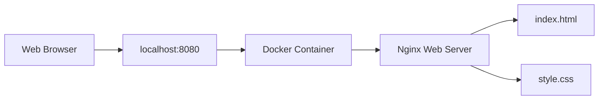

# Dockerized Web Server with Nginx

A hands-on DevOps project that demonstrates how to build and run a static website inside a Docker container using Nginx.

## Project Overview

This project packages an HTML and CSS website into a Docker image and serves it through Nginx. It also includes a Docker health check to verify that the web server is responding correctly.

## Project Screenshots

### Homepage


### Project Details and Footer


## Architecture



## Features

- Custom Docker image built using `nginx:alpine`
- Static website served through Nginx
- Host-to-container port mapping (`8080:80`)
- Docker health check to monitor server availability
- Container logs and status inspection
- Responsive website built with HTML and CSS

## Technologies Used

- Docker
- Nginx
- Linux (Ubuntu on WSL)
- HTML5 and CSS3
- Git and GitHub

## Project Structure

```text
codealpha-docker-webserver/
├── Dockerfile
├── index.html
├── style.css
├── README.md
└── screenshots/
    ├── homepage.png
    └── project-footer.png
```

## Run the Project Locally

### 1. Build the Docker image

```bash
sudo docker build -t codealpha-webserver:v2 .
```

### 2. Start the container

```bash
sudo docker run -d --name codealpha-web -p 8080:80 codealpha-webserver:v2
```

### 3. Open the website

Visit [http://localhost:8080](http://localhost:8080) in your browser.

### 4. Verify the container

```bash
sudo docker ps
sudo docker inspect --format='{{.State.Health.Status}}' codealpha-web
sudo docker logs codealpha-web
```

The health status should become `healthy` after the health check succeeds.

## Container Management

Stop the container:

```bash
sudo docker stop codealpha-web
```

Start it again:

```bash
sudo docker start codealpha-web
```

Remove the container:

```bash
sudo docker rm -f codealpha-web
```

## What I Learned

- Building Docker images from a Dockerfile
- Serving static files with Nginx
- Mapping host ports to container ports
- Adding and checking Docker health checks
- Inspecting logs and managing container lifecycle
- Version-controlling project files with Git and GitHub

## Author

**Himanshu Raj**

Created as a hands-on project for learning Docker and web server deployment as part of a DevOps internship task.
