# Dockerized Web Server with Nginx

A hands-on DevOps project developed as part of my **CodeAlpha DevOps Internship** to gain practical experience with Docker containerization and Nginx web server deployment.

## Project Overview

I built this project to understand how a static website can be packaged into a Docker image and served through an Nginx web server.

The website is created using HTML and CSS, packaged with Docker, and served by Nginx inside a container. A Docker health check is configured to verify that the web server is responding correctly.

## Project Screenshots

### Website Homepage

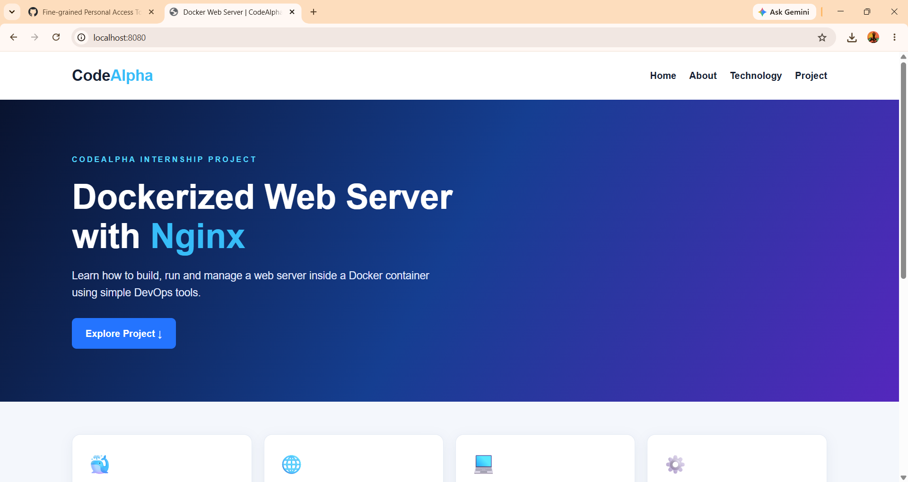

### Website Features and Project Information

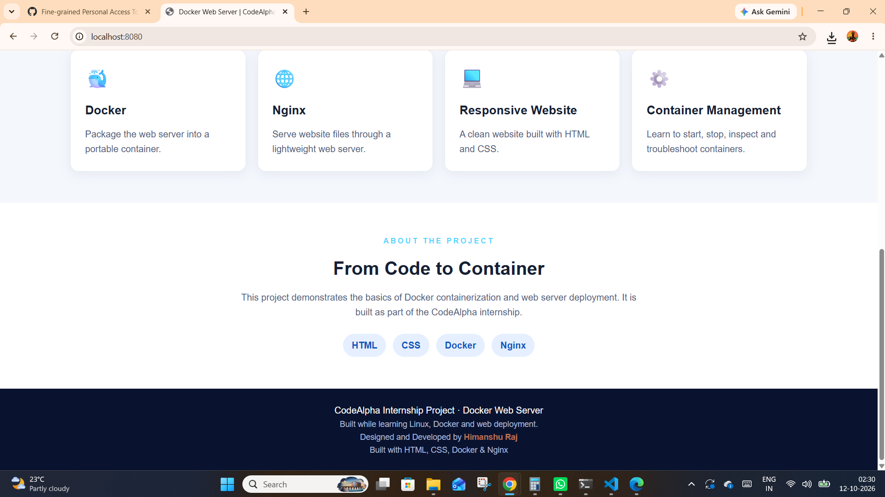

## Architecture

The following diagram shows how a browser request reaches the website running inside the Docker container.

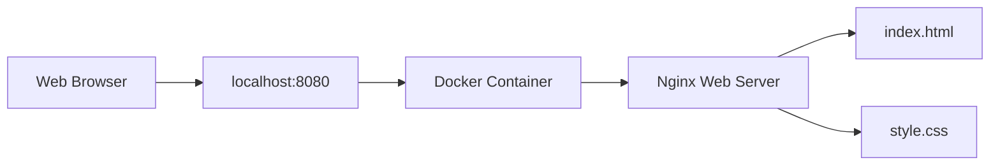

## Features

- Custom Docker image based on `nginx:alpine`
- Static website served using Nginx
- Host-to-container port mapping (`8080:80`)
- Docker health check to verify web server availability
- Container status and server log inspection
- Container lifecycle management
- Controlled troubleshooting and recovery testing
- Responsive website built with HTML and CSS
- Source code version control using Git and GitHub

## Technologies Used

- **Docker** — image building and container management
- **Nginx** — web server
- **Linux (Ubuntu on WSL)** — development environment
- **HTML5 and CSS3** — website structure and styling
- **Git and GitHub** — version control and source code hosting

## Project Structure

```text
codealpha-docker-webserver/
├── Dockerfile
├── index.html
├── style.css
├── README.md
└── screenshots/
    ├── homepage.png
    ├── project-footer.png
    ├── lifecycle-stop.png
    ├── lifecycle-start.png
    ├── lifecycle-restart.png
    ├── health-check.png
    ├── container-logs.png
    ├── troubleshooting-issue-web.png
    ├── troubleshooting-issue-wsl.png
    ├── troubleshooting-issue-restore-web.png
    └── troubleshooting-issue-restore-wsl.png
```

## Run the Project Locally

### Prerequisites

- Docker installed and running
- Git installed
- A web browser

### Step 1: Clone the Repository

```bash
git clone https://github.com/HimanshuRaj02/CodeAlpha_DockerWebServer.git
cd CodeAlpha_DockerWebServer
```

### Step 2: Build the Docker Image

```bash
docker build -t codealpha-webserver:v2 .
```

### Step 3: Start the Container

If a container named `codealpha-web` does not already exist, run:

```bash
docker run -d --name codealpha-web -p 8080:80 codealpha-webserver:v2
```

If the container already exists and is stopped, start it with:

```bash
docker start codealpha-web
```

### Step 4: Open the Website

Open this address in your browser:

[http://localhost:8080](http://localhost:8080)

### Step 5: Verify the Container

Check the running container:

```bash
docker ps
```

Check the container health status:

```bash
docker inspect --format='{{.State.Health.Status}}' codealpha-web
```

View the server logs:

```bash
docker logs --tail 20 codealpha-web
```

The health status should become `healthy` after the health check succeeds.

## Container Management

### Stop the Container

```bash
docker stop codealpha-web
```

### Start the Container Again

```bash
docker start codealpha-web
```

### Restart the Container

```bash
docker restart codealpha-web
```

### Inspect All Containers

```bash
docker ps -a
```

### Remove the Container

```bash
docker rm -f codealpha-web
```

**Note:** Removing the container does not delete the Docker image or project source files. Do not remove the container while it is needed for further testing.

## Verification and Testing

### 1. Container Lifecycle Testing

The container was tested through stop, start, and restart operations. Its state was checked using Docker container-listing commands.

**Stop Test**

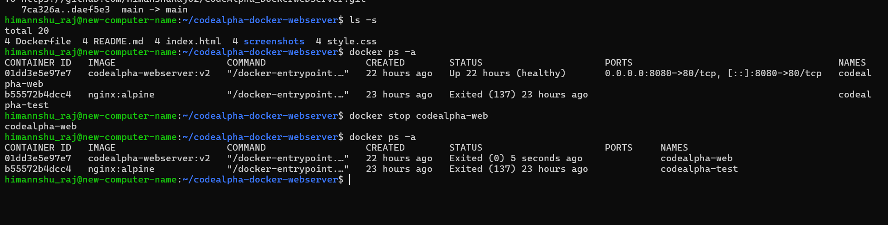

**Start Test**

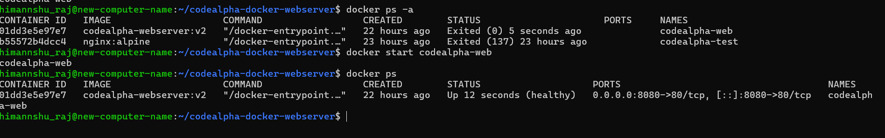

**Restart Test**

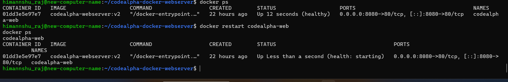

### 2. Health Monitoring

The Docker health status was inspected to verify that the Nginx web server was responding successfully.

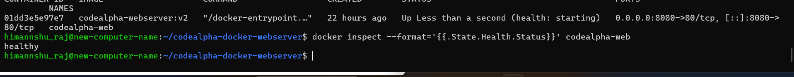

### 3. Container Log Inspection

Container logs were inspected to review Nginx startup messages and HTTP request activity.

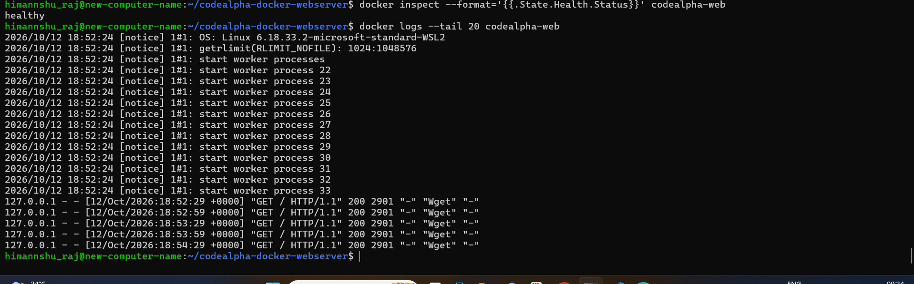

### 4. Troubleshooting and Recovery

A controlled test was performed by temporarily renaming the homepage file inside the running container. The website response was checked, the original file was restored, and recovery was verified.

### 4. Troubleshooting and Recovery

A controlled troubleshooting test was performed by temporarily renaming the homepage file inside the running container. The website response was checked, the original file was restored, and recovery was verified.

**Troubleshooting — Browser Response**

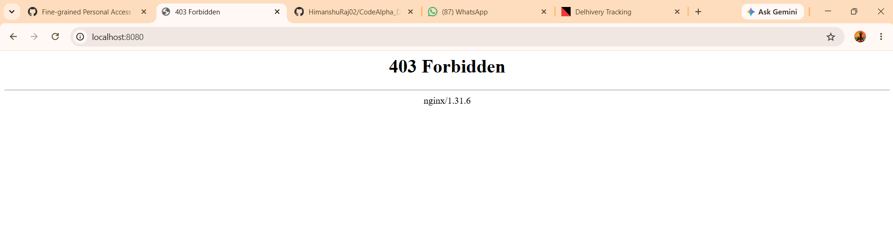

**Troubleshooting — Terminal Output**

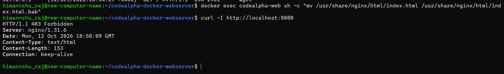

**Website Recovery Verification**

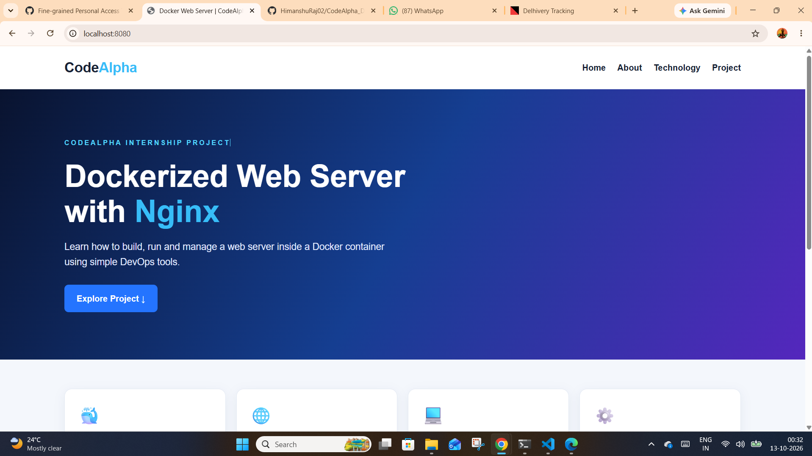

**Recovery Terminal Output**

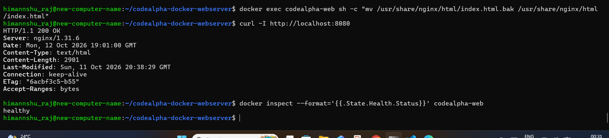
## What I Learned

Through this project, I practised:

- Writing a Dockerfile and building a Docker image
- Running a website inside a Docker container
- Serving static files through Nginx
- Mapping host ports to container ports
- Configuring and checking a Docker health check
- Inspecting container status and server logs
- Managing the container lifecycle
- Troubleshooting a missing web resource and restoring the website
- Using Git and GitHub to maintain project files and documentation

## Internship Context

This project was developed as part of my **CodeAlpha DevOps Internship** to gain hands-on experience with Docker containerization, Nginx web server deployment, container management, and basic troubleshooting.

## Author

**Himanshu Raj**

GitHub: [HimanshuRaj02](https://github.com/HimanshuRaj02)

Project Repository: [CodeAlpha_DockerWebServer](https://github.com/HimanshuRaj02/CodeAlpha_DockerWebServer)
